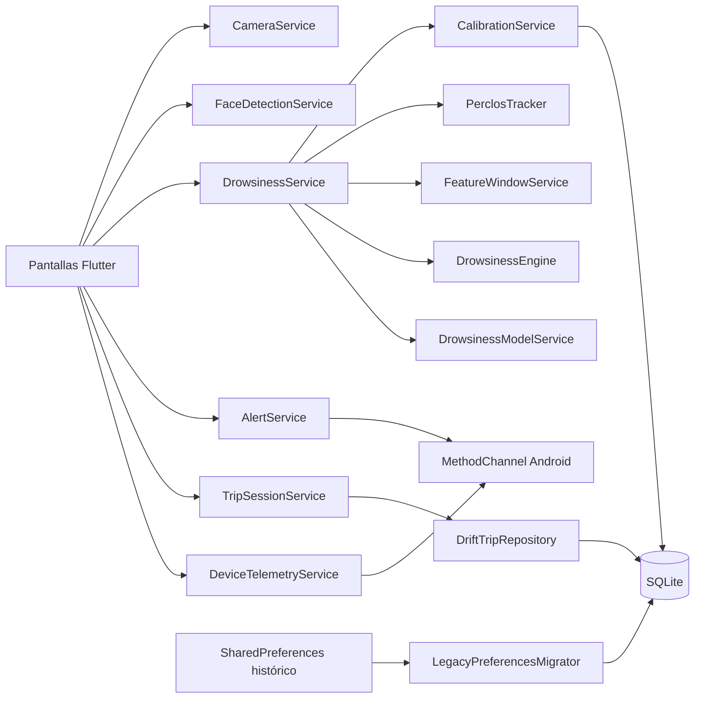

# DriverAwake — Especificación funcional y técnica completa

> **Documento histórico:** varias descripciones de versión, idioma, cuentas, conectividad y GPS quedaron superadas. Para el estado actual consultar [el informe completo de Guardian](INFORME_COMPLETO_DRIVERAWAKEN_GUARDIAN.md) y [la validación ejecutada](../TECHNICAL_VALIDATION.md). Se conserva el contenido original como antecedente.

> Documento maestro del estado real del proyecto al 17 de julio de 2026. Describe lo que está implementado en el código actual, lo que existe como infraestructura experimental y lo que todavía no forma parte del producto. No sustituye documentación legal, certificación vehicular, evaluación médica ni pruebas en dispositivos físicos.

## 1. Identidad y propósito

**Nombre público:** DriverAwake.  
**Nombre del paquete Flutter:** `driveawake`.  
**Versión:** `1.0.0+1`.  
**Application ID Android:** `driver_.awaken` (desde la integración Firebase; antes `com.magicdrive.alert`).
**Idioma configurado:** español (`es`).  
**Mercado inicial previsto:** Perú; cualquier expansión latinoamericana requiere revisión legal por país.

DriverAwake es una aplicación móvil experimental que utiliza la cámara frontal para estimar señales compatibles con cansancio o somnolencia. Combina:

- detección facial local con Google ML Kit;
- probabilidades de apertura ocular proporcionadas por ML Kit;
- geometría aproximada de contornos de ojos y boca;
- orientación de cabeza;
- duración de señales en el tiempo;
- PERCLOS corregido por tiempo y calidad de señal;
- reglas deterministas con suavizado e histéresis;
- calibración personal local;
- un modelo TensorFlow Lite histórico, actualmente rechazado y desactivado;
- alertas visuales, sonoras y hápticas;
- historial y resumen local de viajes;
- telemetría de batería para adaptar carga de procesamiento.

DriverAwake **no** es un dispositivo médico, no es un sistema vehicular certificado, no controla el vehículo, no garantiza que detectará todos los episodios y no sustituye la atención ni la responsabilidad del conductor.

## 2. Alcance actual

### Incluido

- Aplicación Flutter para Android.
- Cámara frontal en tiempo real.
- Detección facial y contornos en el dispositivo.
- Cálculo de ojos cerrados, bostezos, pose, ausencia de rostro y PERCLOS.
- Riesgo `NORMAL`, `PRECAUCION` y `PELIGRO`.
- Cuatro niveles internos de alerta.
- Pausa real del monitoreo.
- Reanudación con cuenta regresiva de tres segundos.
- Pausa segura al pasar a background.
- Recuperación estadística de una sesión interrumpida.
- Historial local filtrable y exportable.
- PDF y PNG diarios compartibles con confirmación.
- Ajustes locales y migración de claves antiguas.
- Retención de historial configurable.
- Calibración automática y guiada.
- Telemetría de batería y temperatura de batería.
- FPS adaptativo.
- Modelo TFLite empaquetado, pero deshabilitado por incompatibilidad comprobada.
- CI de Flutter/Python y workflow manual de release firmado.
- Persistencia Drift/SQLite transaccional con migración automática desde datos históricos.

### No incluido

- Backend, API remota, cuentas o inicio de sesión.
- Sincronización cloud.
- Grabación de vídeo o fotografías.
- Envío de frames a servidores.
- GPS, velocidad del vehículo o navegación.
- Conexión OBD, CAN bus, Android Auto o CarPlay.
- Llamadas automáticas de emergencia.
- Reentrenamiento desde la app.
- Exportación de features técnicas para investigación en la versión actual.
- Modelo validado con conductores completamente retenidos.
- Eliminación inmediata de las claves históricas de `SharedPreferences`; se conservan temporalmente como fallback tras migrarlas.
- Estado térmico oficial de Android; se usa temperatura de batería, no CPU.
- Firma o credenciales release incluidas en el repositorio.
- Política legal definitiva con responsable identificado.

## 3. Plataformas y requisitos

### Flutter/Dart

- Dart SDK: `^3.9.2`.
- Flutter: canal estable compatible con Dart 3.9.2.
- Material Design 3.
- Tema oscuro.
- Tema de alto contraste disponible mediante `highContrastTheme`.
- Localización Material/Cupertino configurada para español.

### Android

- `minSdk = 24`.
- `compileSdk` y `targetSdk` heredados de la instalación Flutter.
- Java/Kotlin target 11.
- Aceleración por hardware habilitada.
- Cámara declarada como característica opcional para permitir un error controlado en equipos sin cámara.
- Permisos declarados: `CAMERA` y `VIBRATE`.
- No se declara permiso de Internet en el manifiesto actual.
- Backup Android deshabilitado con `allowBackup=false` y `fullBackupContent=false`.

## 4. Dependencias principales

| Dependencia | Uso |
|---|---|
| `camera` | Control de cámara y stream de imágenes. |
| `camera_android` | Implementación Android explícita. |
| `permission_handler` | Solicitud del permiso de cámara. |
| `google_mlkit_face_detection` | Rostro, contornos, landmarks, clasificación y tracking. |
| `google_mlkit_commons` | Conversión hacia `InputImage`. |
| `vibration` | Vibraciones cortas y patrones fuertes. |
| `tflite_flutter` | Carga e inferencia del TFLite experimental. |
| `crypto` | Verificación SHA-256 del modelo y orden de features. |
| `shared_preferences` | Origen de migración y fallback temporal de datos históricos. |
| `drift` | ORM, esquema, consultas y transacciones SQLite. |
| `sqlite3_flutter_libs` | Motor SQLite embebido para Android. |
| `path` | Construcción segura de la ruta de la base. |
| `pdf` | Generación de reportes PDF. |
| `path_provider` | Directorio temporal para exportaciones. |
| `share_plus` | Hoja de compartir de Android. |
| `flutter_localizations` | Delegates de español. |

## 5. Configuración global y diseño

`AppConfig` centraliza:

- `productName = DriverAwake`;
- locale español;
- bandera de compilación `DRIVERAWAKE_TECHNICAL_FEATURES`, desactivada salvo definición explícita.

`AppTheme` define:

- fondo `#080B0D`;
- superficie `#11171A`;
- botones grandes, normalmente de 52–56 dp de alto;
- cards oscuras con borde tenue;
- tema oscuro y variante de alto contraste.

`RiskTheme`, una `ThemeExtension`, define colores semánticos:

- normal: verde;
- precaución: ámbar;
- peligro: rojo;
- señal insuficiente: gris;
- pausa: celeste.

Existe un `scaffoldMessengerKey` global. La navegación todavía utiliza principalmente `MaterialPageRoute`; no hay un router declarativo central completamente integrado.

## 6. Arquitectura actual



La pantalla de conducción observa el controlador, renderiza widgets y envía acciones. Toda la coordinación está fuera de la UI, distribuida entre `features/drive/application` e `features/drive/infrastructure`:

- `DriveState`, estado inmutable;
- `DriveSessionPhase`: idle, starting, active, paused, resuming, finishing, completed, recoverableError y fatalError;
- puertos inyectables para cámara, detección, análisis, riesgo, alarmas, viajes, borradores, telemetría, lifecycle, reloj y logger;
- `DriveSessionResources`, interfaz del runtime;
- `FlutterDriveSessionResources`, coordinación productiva de frames y dispositivos;
- `DriveSessionController`, única fuente de verdad, comprobado con fakes.

El controlador cubre inicialización, recuperación, pausa idempotente, reanudación única, cancelación por background, errores recuperables/fatales, reconocimiento de peligro, finalización/descarte idempotentes y limpieza. No existe una segunda implementación de pausa o finalización en `DriveModeScreen`.

## 7. Pantallas y experiencia

### 7.1 Inicio

La pantalla de inicio presenta:

- identidad visual DriverAwake;
- estado “MONITOREO LISTO”;
- explicación de procesamiento local;
- botón principal `INICIAR VIAJE`;
- accesos a `HISTORIAL` y `AJUSTES`;
- indicadores de ojos, cabeza y alertas;
- panel técnico resumido de batería, temperatura, modelo y calibración;
- panel de cámara con inicio automático.

La cámara se enciende al abrir Inicio después de resolver un posible borrador incompleto y conceder el permiso del sistema. La vista previa:

- usa resolución media, igual que el modo conducción, para evitar combinaciones de superficies incompatibles en CameraX;
- inicia ML Kit y muestra preview/landmarks;
- procesa como máximo un frame a la vez;
- permanece activa mientras Inicio está visible, sin límite de 25 segundos;
- se cancela al abandonar la pantalla;
- se restaura al volver a Inicio o regresar del segundo plano;
- serializa apertura/cierre y descarta resultados de operaciones anteriores;
- muestra riesgo `--` cuando no hay cámara o rostro disponible;
- libera cualquier controlador fallido antes de reintentar y no considera fatal que una cámara frontal no exponga control de flash.

La vista previa no inicia un viaje ni activa alarmas. `HISTORIAL > Informes de viajes` permite abrir los resúmenes completos guardados en SQLite, incluso sin alertas. Respeta la retención configurada y el borrado del historial. El botón de nube permite crear una cuenta opcional y copiar resúmenes a Firebase tras confirmación; véase `firebase_setup.md`.

Al iniciar la app, Inicio busca un borrador incompleto. Si existe, ofrece:

- `Recuperar`: abre el viaje en pausa, sin cámara ni alarma;
- `Descartar`: elimina eventos asociados y el borrador.

La recuperación conserva estadísticas; no interpreta que el monitoreo de seguridad siga activo.

### 7.2 Modo conducción

Al entrar normalmente:

1. crea un identificador `trip_<timestamp_ms>`;
2. guarda un borrador inicial;
3. mantiene la pantalla encendida;
4. inicializa ajustes, calibración y servicio de somnolencia;
5. solicita cámara;
6. selecciona cámara frontal o, si no existe, la primera cámara disponible;
7. inicializa resolución media, audio deshabilitado, flash apagado;
8. inicia stream YUV420 en Android;
9. inicia telemetría periódica cada 12 segundos.

La interfaz muestra:

- preview de cámara;
- guía visual de posición del rostro;
- landmarks/contornos;
- nivel y puntuación de riesgo;
- estado de rostro y señal;
- métricas compactas;
- acciones de pausa, calibración, métricas y finalización;
- overlay de calibración;
- overlay de pausa;
- overlay prioritario de peligro.

El preview usa recorte centrado para cubrir el visor sin deformar la imagen ni dejar una franja vertical. Las cinco métricas esenciales permanecen en una barra compacta; el diagnóstico completo se abre en una hoja modal desplazable para no reducir el área útil de cámara.

#### Procesamiento de frames

- Solo un frame puede estar en procesamiento (`_isBusy`).
- Los frames recibidos mientras el procesador está ocupado se descartan.
- Se respeta el intervalo solicitado por `AdaptiveFrameScheduler`.
- El timestamp del último frame aceptado evita acumulación.
- Cada frame se convierte a `InputImage` respetando formato, rotación y planos.
- ML Kit devuelve rostros.
- Si hay varios, se analiza el rostro con mayor bounding box.
- Se estima brillo desde el plano de luminancia.
- Se calcula FPS real mediante timestamps recientes.
- El estado resultante alimenta UI, alertas, historial y borrador.

#### Pausa

Pausar significa detener realmente el monitoreo:

- marca la sesión como pausada;
- invalida cuentas regresivas anteriores;
- detiene el stream;
- bloquea procesamiento e inferencias nuevas;
- cancela timer de telemetría;
- desactiva mantener pantalla encendida;
- detiene audio y vibración;
- reinicia PERCLOS, ventanas, suavizadores y trackers temporales;
- vacía timestamps de FPS;
- conserva estadísticas y borrador;
- muestra `MONITOREO PAUSADO`.

La operación es idempotente.

#### Reanudación

- Solo funciona desde pausa.
- Muestra 3, 2 y 1, un segundo cada valor.
- No procesa frames durante la cuenta regresiva.
- Si la app pierde foco, la generación de reanudación se invalida.
- Inicializa la cámara si fue liberada.
- Reinicia estado temporal antes del stream.
- Reactiva sesión, telemetría y pantalla encendida.
- Evita crear un segundo stream si ya existe uno.

#### Lifecycle

Al recibir `inactive` o `paused`:

- marca que la app no está en primer plano;
- invalida reanudaciones;
- apaga keep-screen-on;
- pausa recursos y alertas.

Al volver a `resumed`, la cámara no se reactiva silenciosamente. El usuario debe reanudar.

#### Salida y finalización

`PopScope` impide perder un viaje al pulsar Atrás. El diálogo ofrece:

- continuar conduciendo;
- finalizar y guardar;
- descartar viaje.

Descartar exige una segunda confirmación. Finalizar y descartar comparten la detención segura de recursos. Un guard `_finishing` impide llamadas duplicadas.

#### Reconocimiento de peligro

El usuario puede reconocer una alerta crítica. Esto:

- registra el momento del reconocimiento;
- detiene audio y vibración;
- no deshabilita el sistema;
- aplica una gracia de 30 segundos;
- permite que el overlay reaparezca si el peligro persiste.

### 7.3 Resumen del viaje

Muestra:

- título calculado: viaje seguro, señales de cansancio o recomendación de descanso;
- mensaje explicativo;
- duración de conducción acumulada;
- alertas de precaución y peligro;
- bostezos;
- tiempo de ojos cerrados;
- eventos sin rostro;
- riesgo medio y máximo;
- nivel dominante;
- batería inicial/final y delta;
- temperatura de batería inicial/final/máxima y delta;
- estado de carga al cierre;
- botón para volver al Inicio.

La recomendación de descanso se activa si hubo peligro, riesgo máximo ≥ 80 o promedio ≥ 55. El mensaje moderado aparece si hubo precauciones, al menos dos bostezos o promedio ≥ 35.

### 7.4 Historial

El historial:

- carga eventos locales ordenados del más reciente al más antiguo;
- filtra por Todos, Normal, Precaución o Peligro;
- agrupa por día;
- presenta cantidad y detalle por evento;
- permite borrar todo con confirmación irreversible;
- exporta un día en PDF o PNG;
- exige confirmación antes de compartir;
- advierte que un tercero puede conservar la copia;
- elimina el archivo temporal al terminar el diálogo de compartir.

Los reportes contienen identidad DriverAwake, resumen diario y eventos; no incluyen imágenes, vídeo ni rutas internas en el contenido visible.

### 7.5 Ajustes

#### Detección

- Sensibilidad baja: multiplicador de riesgo `0.88`.
- Sensibilidad media: `1.00`, valor predeterminado.
- Sensibilidad alta: `1.12`.
- Modelo IA local: desactivado por defecto; aunque se active, el modelo actual es rechazado por incompatibilidad.
- Panel técnico: desactivado por defecto.
- Ventana PERCLOS: ajustable entre 10 y 90 segundos.

#### Retención

- 7 días.
- 30 días, valor predeterminado.
- 90 días.
- Sin borrado automático.

Al cambiar la retención se filtra y reescribe el almacenamiento, eliminando realmente eventos vencidos.

#### Alertas

- Activar/desactivar sonido.
- Activar/desactivar vibración.
- Probar alarma local real.

Desactivar sonido o vibración durante operación provoca la detención del actuador correspondiente en el siguiente manejo de estado.

#### Datos locales

- Restablecer calibración.
- Borrar historial con confirmación.
- Restablecer ajustes predeterminados.
- Abrir aviso de privacidad.

### 7.6 Privacidad

La pantalla es un **aviso preliminar**, no una política legal definitiva. Indica:

- ámbito inicial Perú;
- procesamiento de cámara local;
- ausencia de grabación de vídeo/imágenes;
- datos almacenados;
- conservación y eliminación;
- exportación explícita;
- uso local de ML Kit/TFLite;
- derechos ARCO;
- identidad y canal del responsable pendientes;
- límites experimentales del producto.

## 8. Cámara y detección facial

`CameraService`:

- solicita permiso en runtime;
- diferencia denegación y denegación permanente;
- falla claramente si no hay cámaras;
- prefiere lente frontal;
- usa `YUV420` en Android y `BGRA8888` en iOS;
- deshabilita audio;
- apaga flash;
- hace `startImageStream` idempotente;
- detiene stream antes de liberar controller.

`FaceDetectionService` configura ML Kit con:

- `performanceMode.fast`;
- contornos;
- clasificación;
- landmarks;
- tracking.

`InputImageConverter` adapta formatos y rotación para ML Kit y devuelve `null` ante combinaciones no soportadas en lugar de cerrar la aplicación.

## 9. Señales calculadas

### Ojos

- Promedio de probabilidades de ojo izquierdo/derecho.
- EAR aproximado como alto/ancho del bounding de contorno ocular.
- Suavizado de probabilidad ocular: 4 muestras.
- Suavizado EAR: 5 muestras.
- Ojo cerrado si probabilidad suavizada `< 0.35` o EAR menor al umbral calibrado.
- La decisión solo usa landmarks como confiables si calidad ≥ 0.36 y no hay baja luz.

### Boca/bostezo

- MAR aproximado desde contornos superior/inferior de labios.
- Suavizado de 5 muestras.
- Bostezo si MAR supera umbral calibrado.
- Cuenta transiciones hacia bostezo, no cada frame.
- Ventana de bostezos: 60 segundos.
- Tres bostezos en ventana constituyen evidencia fuerte.

### Cabeza

- `headEulerAngleX` para inclinación vertical.
- `headEulerAngleY` para distracción lateral.
- Suavizado de 5 muestras.
- Umbrales base: 22° cabeza inclinada y 28° distracción.
- Confirmación temporal: 750 ms para cabeza y 1400 ms para distracción.

### Ausencia de rostro

- 600 ms: precaución temprana.
- 2 s: evidencia elevada.
- 4 s: peligro crítico forzado.
- Resetea trackers de ojos, pose y bostezo.
- Añade a PERCLOS una muestra inválida, nunca “ojos cerrados”.

### Iluminación y calidad

- Brillo `< 34`: baja iluminación.
- Brillo entre 34 y 48: iluminación débil.
- Calidad comienza en 0.22 y suma disponibilidad de EAR, MAR, probabilidad ocular y tamaño relativo del rostro.
- Baja luz multiplica la calidad por 0.45; luz débil por 0.72.
- Calidad final limitada a `[0,1]`.
- Si calidad `< 0.32` y no existe regla crítica, el riesgo de reglas se limita a 48.

## 10. PERCLOS

PERCLOS representa la proporción del tiempo observado válido con ojos cerrados.

Características de seguridad:

- Ventana predeterminada: 30 s; configurable 10–90 s.
- Hueco máximo integrable: 600 ms.
- Duración observada válida mínima: 10 s.
- Cobertura mínima: 55 %.
- Ignora timestamps duplicados o fuera de orden.
- Solo integra entre dos muestras válidas consecutivas.
- Una muestra inválida rompe el segmento.
- Un hueco largo rompe el segmento.
- Ausencia de rostro no incrementa tiempo cerrado.
- `validCoverage` y PERCLOS se limitan a `[0,1]`.
- Se reinicia en pausa, reanudación, finalización y reinicio temporal.

Umbrales del motor:

- PERCLOS ≥ 0.20: riesgo de reglas 44.
- PERCLOS ≥ 0.35: riesgo de reglas 78.
- No se usa como señal lista con poca cobertura, baja luz o landmarks no confiables.

## 11. Motor de riesgo

El motor elige la evidencia de reglas más alta, combina opcionalmente modelo, aplica sensibilidad, suavizado e histéresis.

| Condición | Riesgo objetivo | Crítica |
|---|---:|---|
| Iluminación insuficiente | 22 | No |
| Rostro ausente ≥ 600 ms | 42 | No |
| Rostro ausente ≥ 2 s | 62 | No |
| Rostro ausente ≥ 4 s | 90 | Sí |
| Ojos cerrados instantáneos | 25 | No |
| Ojos cerrados ≥ 1.5 s | 56 | No |
| Ojos cerrados ≥ 3 s | 96 | Sí |
| Ojos cerrados + cabeza caída confirmada | 92 | Sí |
| PERCLOS ≥ 0.20 | 44 | No |
| PERCLOS ≥ 0.35 | 78 | No |
| Bostezo actual | 30 | No |
| ≥ 3 bostezos en 60 s | 76 | No |
| Cabeza inclinada sostenida | 42 | No |
| Distracción sostenida | 41 | No |

### Suavizado

- Al subir: alpha 0.48.
- Al bajar: alpha 0.16.
- Si la distancia al objetivo es menor que 1, adopta el objetivo.
- Las reglas críticas fuerzan como mínimo 70 y evitan el suavizado de subida.

### Niveles e histéresis

- Normal: riesgo menor de 40.
- Precaución: riesgo ≥ 40.
- Peligro: riesgo ≥ 70 o regla crítica.
- Para salir de Peligro debe bajar de 62.
- Para salir de Precaución debe bajar de 34.

### Mensajes

- Normal: `Conduccion normal`.
- Precaución: `Cuidado: <motivo>`.
- Peligro general: `ALERTA: posible somnolencia`.
- Peligro por rostro ausente: `ALERTA: no se detecta rostro`.
- Baja luz sin peligro: instrucción para mejorar iluminación.

## 12. Alertas

| Tier | Estado | Comportamiento |
|---:|---|---|
| 0 | Normal | Detiene audio/vibración y reinicia cooldowns. |
| 1 | Precaución baja | Solo indicación visual. |
| 2 | Precaución con riesgo ≥ 55 | Vibración corta configurable. |
| 3 | Peligro | Audio local + vibración fuerte. |
| 4 | Peligro sostenido ≥ 14 s | Audio repetido 3 veces + patrón más intenso. |

Cooldowns:

- Precaución: 18 s.
- Peligro: 7 s.
- Reconocimiento de peligro: gracia de 30 s.

Vibración corta: 220 ms/amplitud 180, con fallback 180 ms.  
Patrón tier 3: `[0,350,120,450,120,650]`.  
Patrón tier 4: `[0,500,100,600,100,800,160,900]`.  
Si no hay soporte de patrón, usa 900 o 1400 ms. Existe fallback de 700 ms.

`AlertService.stopAllAlerts()` es idempotente, detiene MediaPlayer nativo y cancela vibración. Se llama en normalidad, pausa, background, finalización, error de cámara y dispose.

## 13. Calibración personal

### Automática

- Requiere 45 muestras válidas.
- Requiere al menos 10 s.
- Descarta rostro ausente, EAR inválido, ojos cerrados o probabilidad ocular abierta < 0.60.
- Calcula medianas de EAR abierto, MAR normal, pose X/Y y tamaño facial.

### Guiada

Duración nominal: 26 s.

| Intervalo | Instrucción |
|---|---|
| 0–5 s | Mira al frente. |
| 5–10 s | Mantén ojos abiertos. |
| 10–14 s | Parpadea normalmente. |
| 14–18 s | Cierra ojos por 1 segundo. |
| 18–22 s | Abre la boca una vez. |
| 22–26 s | Mueve ligeramente la cabeza. |

Guarda:

- EAR abierto/cerrado;
- MAR normal/bostezo;
- baseline de cabeza X/Y;
- tamaño relativo de rostro.

Deriva umbrales limitados a rangos seguros. Si no hay calibración usa 0.16 EAR, 0.55 MAR, 22° y 28°.

La clave activa todavía se llama `magicdrive_personal_calibration_v2`. Existe un `PersonalCalibrationService` v1 heredado sin referencias en el flujo principal; se conserva para no eliminar datos/código sin una migración explícita.

## 14. Muestreo adaptativo y batería

`AdaptiveFrameScheduler` solicita:

| Situación | Intervalo | FPS aproximado |
|---|---:|---:|
| Normal | 220 ms | 4.55 |
| Precaución/peligro/calibración | 110 ms | 9.09 |
| Batería ≤ 15 %, sin cargar | 300 ms | 3.33 |
| Temperatura batería elevada ≥ 40 °C | 400 ms | 2.5 |
| Temperatura batería crítica ≥ 44 °C | 500 ms | 2.0 |

La salida de estados térmicos usa histéresis de 2 °C. El dato es temperatura reportada por `ACTION_BATTERY_CHANGED`; no representa necesariamente CPU, GPU ni estado térmico oficial Android.

Telemetría disponible:

- porcentaje de batería;
- temperatura de batería en °C;
- voltaje mV;
- status y tipo de conexión/carga;
- timestamp.

## 15. Estado de monitoreo

`DrowsinessState` contiene:

- nivel;
- rostro detectado;
- ojos cerrados y parpadeo prolongado;
- bostezo;
- cabeza caída y distracción;
- ausencia prolongada;
- eye-open score, EAR y MAR;
- PERCLOS y disponibilidad;
- ángulos X/Y;
- duraciones de ojos, rostro, cabeza y distracción;
- bostezos en ventana;
- riesgo total, por reglas y por modelo;
- motivo, mensaje y tier;
- duración de peligro sostenido;
- baja luz, brillo, calidad y FPS;
- disponibilidad, etiqueta, confianza y probabilidades del modelo;
- estado, progreso e instrucción de calibración.

## 16. Modelo TensorFlow Lite

### Activo empaquetado

- Archivo: `assets/models/drowsiness_mlp.tflite`.
- Versión declarada: `experimental-2026-05-23`.
- Extractor de entrenamiento: `legacy-mediapipe-v1`.
- Extractor Flutter: `mlkit-flutter-v1`.
- Input: `[1,181]`.
- Output: `[1,3]`.
- Clases: despierto, cansancio, somnoliento.
- SHA-256: `e29e3b6017ad897a319afe7968b5bca3213f12a5551a3853b9e3cb5671f1c34f`.
- Paridad: `false`.
- Estado: `disabled_by_default`.

### Validaciones al cargar

- SHA del binario.
- `parity_verified`.
- versión de extractor.
- hash del orden de features.
- orden exacto de clases.
- shapes de manifiesto e intérprete.
- 181 columnas de preprocessing.

### Validaciones al inferir

- input imputado y escalado;
- output exactamente de tres elementos;
- probabilidades finitas;
- suma entre 0.98 y 1.02;
- cierre del intérprete y desactivación para la sesión ante error.

El modelo actual siempre se rechaza antes de inferir porque `parity_verified=false` y su extractor histórico no coincide. Activar el switch de ajustes **no elude** este control.

### Features

`FeatureWindowService`:

- agrupa ventanas de 10 s;
- exige al menos 8 muestras actuales;
- conserva hasta 12 ventanas completadas;
- calcula 181 features;
- incluye ratios de rostro, EAR, MAR, PERCLOS, conteos, pose, diferencias, rolling 3/6/12 e indicadores acumulativos;
- infiere como máximo una vez por segundo.

El orden completo y tipos están en `shared/model_contract/feature_schema.json` y `shared/model_contract/model_contract.json`. La normalización usa mediana para faltantes y StandardScaler con metadata empaquetada.

El contrato declara que métricas históricas no son confiables como holdout por sujeto. No hay umbral recomendado validado.

## 17. Viajes, eventos y persistencia

### Borrador incremental

Tabla principal: `session_drafts`. Clave histórica migrada: `driverawake_incomplete_trip_v1`.

Campos:

- ID, inicio y última actualización;
- duración acumulada;
- alertas warning/danger;
- bostezos y eventos sin rostro;
- muestras normal/warning/danger;
- cantidad de muestras, suma y máximo de riesgo;
- duración de ojos cerrados;
- pausa e indicador incompleto.

Se guarda:

- al iniciar;
- al pausar/reanudar;
- en cambios de nivel;
- como máximo cada 15 s durante observación estable.

Las escrituras se serializan para que finalizar no compita con una escritura pendiente. Finalizar espera, elimina borrador y produce resumen. Descartar elimina eventos del viaje y borrador.

### Eventos

Tabla principal: `trip_events`.  
Claves históricas migradas: `driverawake_event_history_v1` y `magicdrive_event_history_v1`.  
Máximo: 600 eventos.

Campos por evento:

- ID y timestamp;
- nivel;
- tipo;
- duración;
- riesgo y PERCLOS;
- etiqueta/confianza del modelo cuando existen;
- trip ID;
- notas/motivo.

Tipos generados:

- `alerta_precaucion`;
- `alarma_critica`;
- `bostezo`;
- `rostro_ausente`;
- `ojos_cerrados_prolongados`;
- `cabeza_caida`;
- `distraccion`;
- `perclos_alto`;
- `modelo_somnolencia`.

Existe cooldown de 6 s por tipo para no llenar el historial con el mismo evento.

### Ajustes

Tabla principal: `app_settings`.  
Claves históricas migradas automáticamente: `driverawake_app_settings_v1` y `magicdrive_app_settings_v1`.

Si el JSON es inválido, se elimina y vuelven valores seguros predeterminados.

### Esquema y transacciones

El esquema Drift versión 1 contiene `trips`, `trip_events`, `session_drafts`, `calibrations`, `app_settings` y `model_metadata`. Activa claves foráneas, cascada de eventos por viaje e índices por timestamp, trip ID y nivel. Finalización, descarte, borrado de historial y retención son transaccionales. La base todavía no está cifrada.

## 18. Android nativo

`MainActivity.kt` expone `com.magicdrive.alert/device`:

- `getBatteryThermal`;
- `playAlarm` con repeat limitado 1–4;
- `stopAlarm`;
- `setKeepScreenAwake`.

La alarma usa `MediaPlayer` con `res/raw/magicdrive_alarm.wav`, repite con `seekTo(0)`, libera recursos al terminar y también en `onDestroy`.

Keep-screen-on usa `FLAG_KEEP_SCREEN_ON` y siempre se limpia en destrucción.

El application ID Android es `driver_.awaken`, elegido para coincidir con la app registrada en Firebase. Namespace y canal mantienen `com.magicdrive.alert`. Se instala como una app diferente de la variante anterior.

## 19. Privacidad y seguridad

- No se guardan imágenes ni vídeo.
- No hay permiso Internet declarado.
- No hay backend.
- Backup Android deshabilitado.
- Exportación confirmada y temporal.
- Retención configurable y borrado local.
- `.gitignore` excluye datasets, entornos, builds, `.env`, keystores y `key.properties`.
- CI ejecuta Gitleaks y control de archivos prohibidos.
- El aviso inicial está orientado a Perú y deja datos legales pendientes.
- No existe cifrado casero.

La plantilla legal referencia Ley peruana N.° 29733, DS N.° 016-2024-JUS y derechos ARCO, pero exige revisión profesional antes de publicación.

## 20. Firma y compilación

### Debug

El APK debug verificado se genera en:

`driveawake/build/app/outputs/flutter-apk/app-debug.apk`

### Release

- Release no usa firma debug.
- Si la tarea contiene `release`, Gradle exige `android/key.properties`.
- Exige alias, passwords y ruta de keystore no vacíos.
- Exige que el keystore exista.
- Activa R8 y shrinkResources.
- Incluye reglas ProGuard para Flutter, ML Kit y TFLite.

Workflow manual `release.yml`:

- requiere environment `production`;
- lee cuatro secretos de GitHub;
- reconstruye keystore temporal;
- ejecuta tests;
- genera AAB firmado;
- genera SHA-256;
- sube AAB/checksum;
- elimina material temporal con `if: always()`.

Secretos esperados:

- `ANDROID_KEYSTORE_BASE64`;
- `ANDROID_KEY_ALIAS`;
- `ANDROID_KEY_PASSWORD`;
- `ANDROID_STORE_PASSWORD`.

## 21. Pipeline Python de ML

Directorio: `app_conductores_ml`.

Funciones principales:

- inspección de dataset;
- extracción MediaPipe histórica;
- ingeniería temporal;
- entrenamiento MLP/TFLite;
- búsqueda logística;
- Random Forest;
- comparación de modelos;
- exportación de assets Flutter;
- predicción de muestras;
- validación de reglas;
- validación de contrato/hash;
- ejecución agrupada de fase 2.

`splitting.py` exige `subject_id`, valida que no sea vacío/desconocido, crea train/validation/test agrupado, evalúa varias semillas y ofrece `StratifiedGroupKFold`. El entrenamiento se detiene si un sujeto aparece en más de un split.

Estado actual:

- 11 tests Python aprobados;
- Ruff aprobado;
- contrato y hash aprobados;
- métricas históricas no aceptadas como validación por sujeto;
- reentrenamiento pospuesto por decisión del proyecto.

## 22. Contrato compartido

`shared/model_contract` contiene:

- `model_contract.json`;
- `feature_schema.json`;
- explicación de compatibilidad.

`shared/test_vectors` contiene:

- raw features;
- expected scaled input;
- manifest;
- placeholders explícitos para métricas de frames, features temporales y probabilidades aún no verificadas.

Python y Dart comparten el golden de imputación/escalado con tolerancia absoluta `1e-4`.

## 23. Pruebas automatizadas

### Flutter

- FPS adaptativo, batería y temperatura.
- Cooldown de alertas.
- cancelación idempotente con actuador falso.
- controlador de sesión: inicio, pausa doble, reanudación, background y finish doble.
- reglas críticas, IA débil y baja luz.
- preprocesamiento, metadata y NaN.
- 10 escenarios PERCLOS.
- migración de ajustes.
- retención física de historial.
- borradores.
- aviso de privacidad.
- smoke test de Inicio.

Última suite completa ejecutada: 49 pruebas aprobadas. `dart analyze` final: sin problemas.

### Python

- extracción/validación de grupos;
- cero fuga;
- reproducibilidad;
- variación por semilla;
- equilibrio razonable;
- errores por metadata/folds insuficientes;
- contrato, orden, hash y golden.

## 24. Integración continua

`ci.yml` ejecuta:

- checkout;
- Flutter stable con cache;
- `flutter pub get`;
- formato;
- análisis;
- tests;
- APK debug;
- Python 3.11 con cache pip;
- Ruff;
- pytest;
- validación del contrato;
- Gitleaks;
- higiene de firma/datasets.

`release.yml` gestiona releases manuales firmados como se describió anteriormente.

## 25. Assets

- `assets/logo.png`: logo de aplicación.
- `assets/audio/magicdrive_alarm.wav`: audio Flutter declarado.
- `android/app/src/main/res/raw/magicdrive_alarm.wav`: audio nativo usado por MediaPlayer.
- `assets/models/drowsiness_mlp.tflite`: modelo experimental.
- `assets/models/preprocessing_metadata.json`: columnas, medianas, medias y desviaciones.
- `assets/models/model_manifest.json`: versión, hash, shapes y compatibilidad.
- iconos launcher en densidades mdpi a xxxhdpi.

## 26. Inventario lógico del código Flutter

### App

- `main.dart`: inicialización y `runApp`.
- `app/app.dart`: MaterialApp, localización, tema y Home.
- `app/app_config.dart`: identidad y flags.
- `app/app_theme.dart`: tema y colores de riesgo.

### Modelos

- ajustes;
- estado de somnolencia;
- métricas de frame;
- predicción ML;
- evento;
- telemetría;
- borrador y resumen de viaje;
- estado de controlador de sesión.

### Servicios

- cámara;
- detector facial;
- conversión de imagen;
- análisis de somnolencia;
- motor de riesgo;
- PERCLOS;
- features temporales;
- modelo/preprocesamiento;
- calibración;
- alertas;
- telemetría nativa;
- viajes, borradores e historial;
- exportación PDF/PNG;
- ajustes.

### Widgets

- overlay de alerta;
- panel técnico;
- overlay de landmarks;
- tarjeta de estado.

### Pantallas

- Inicio;
- conducción;
- resumen;
- historial;
- ajustes;
- privacidad.

## 27. Manejo de fallos y degradación

- Permiso/cámara inexistente: error visible.
- Fallo transitorio de un frame: no detiene la sesión.
- InputImage incompatible: frame descartado.
- Stream ya activo: no crea otro.
- Modelo incompatible: reglas deterministas siguen funcionando.
- NaN/infinito del modelo: modelo desactivado para la sesión.
- JSON de ajustes/borrador inválido: se elimina y degrada a defaults/null.
- Plugin nativo ausente: telemetría devuelve null; alarma usa `SystemSound` como fallback.
- Vibración sin capacidades avanzadas: patrón simplificado.
- Baja señal: limita reglas no críticas, pero no anula ojos cerrados críticos ni ausencia prolongada.
- Background: pausa y detiene alertas.

## 28. Limitaciones y deuda técnica conocida

1. El modelo no tiene paridad ML Kit/MediaPipe ni validación retenida.
2. No se ha realizado reentrenamiento con features reales del móvil.
3. Falta prueba prolongada en varios Android físicos.
4. No se usa la API oficial de estado térmico Android.
5. `DriveModeScreen` ya depende solo de `DriveSessionController`, pero sus widgets privados todavía pueden separarse en archivos menores.
6. La base SQLite es transaccional, pero todavía no está cifrada.
7. Las claves históricas de `SharedPreferences` se conservan temporalmente como fallback y requieren una futura política de retiro.
8. Hay dos servicios de calibración; el v1 está obsoleto/no referenciado.
9. La calibración guiada todavía puede derivar algunos fallbacks si no captura una etapa ideal; requiere endurecimiento UX antes de piloto.
10. No existe onboarding completo de primer uso.
11. Accesibilidad es parcial: hay Semantics en privacidad y varios tooltips, pero falta auditoría integral WCAG/lector de pantalla/daltonismo.
12. La observabilidad mide selección de rostro, extracción, PERCLOS, motor y modelo; falta validar el overhead y calibrar umbrales del watchdog con una matriz amplia de dispositivos físicos.
13. Algunas rutas importantes aún capturan excepciones de forma silenciosa; falta logger estructurado completo.
14. Se creó un baseline Git local el 2026-07-18; no existe todavía un remoto verificado ni política de ramas aplicada.
15. La identidad legal, canal ARCO y política definitiva siguen pendientes.
16. No se ha ejecutado release firmado dentro de CI con secretos reales.

## 29. Comandos de desarrollo y validación

```bash
cd driveawake
flutter pub get
dart format --output=none --set-exit-if-changed lib test
flutter analyze
flutter test
flutter build apk --debug
```

```bash
cd app_conductores_ml
venv/Scripts/python.exe -m ruff check .
venv/Scripts/python.exe -m pytest -q
venv/Scripts/python.exe src/validate_model_contract.py
```

En Windows, Flutter necesita permiso de escritura sobre `C:\flutter\bin\cache` para crear su lockfile.

## 30. Estado de preparación

| Etapa | Estado |
|---|---|
| Desarrollo local | Funcional y analizable. |
| Tests automatizados | Flutter y Python aprobados en el entorno auditado. |
| APK debug | Generado correctamente. |
| Pruebas internas controladas | Posibles, con supervisión y sin confiar en el modelo experimental. |
| Prueba en conducción real | No recomendada todavía. |
| Piloto controlado | Pendiente de dispositivos, protocolo, privacidad definitiva y validación. |
| Publicación comercial | No apta todavía. |
| Modelo ML | Empaquetado pero deliberadamente inhabilitado. |

## 31. Fuentes de verdad relacionadas

- Arquitectura: `docs/architecture.md`.
- Auditoría inicial: `docs/initial_audit.md`.
- Seguridad fase 1: `docs/phase_1_safety_report.md`.
- Validación ML: `docs/ml_validation_report.md`.
- Privacidad Perú: `docs/privacy_policy_template.md`.
- Releases: `docs/release_process.md`.
- Contrato exacto: `shared/model_contract/model_contract.json`.
- Lista exacta de 181 features: `shared/model_contract/feature_schema.json`.
- Manifiesto del binario móvil: `driveawake/assets/models/model_manifest.json`.
- Observabilidad y watchdog: `docs/performance_observability.md`.
- Pruebas prolongadas: `docs/device_test_protocol.md`.

---

Este documento debe actualizarse cuando cambien reglas, umbrales, permisos, dependencias, persistencia, modelo, política legal o workflows de distribución.
