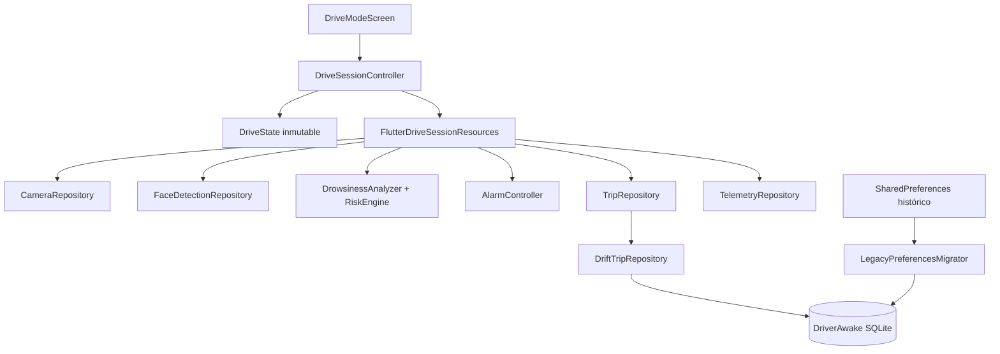
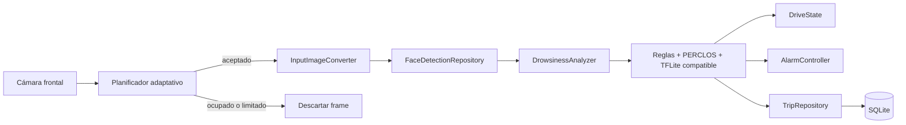
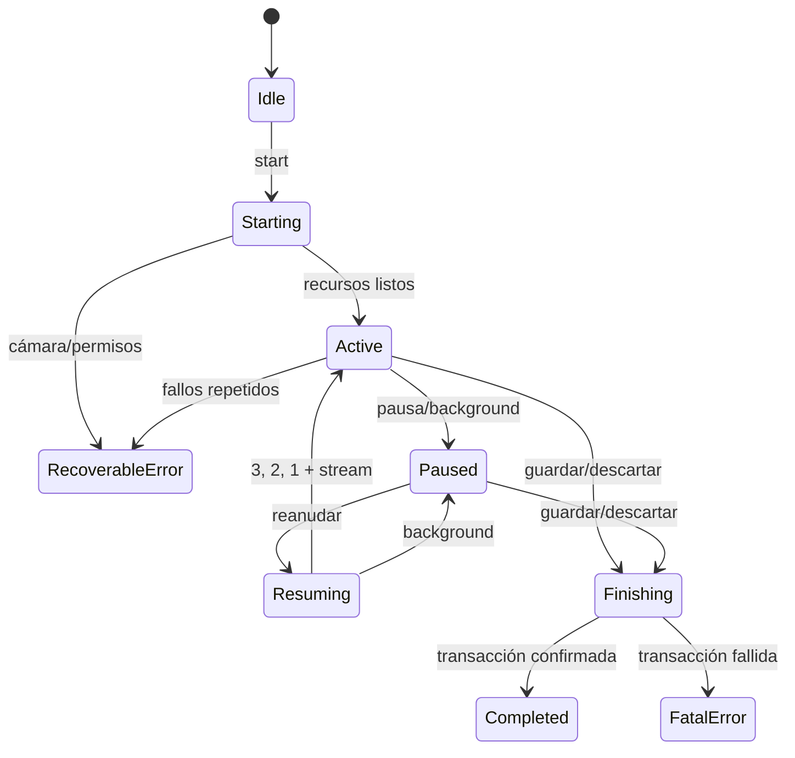

# Arquitectura de DriverAwake

## Estado implementado

La sesión de conducción usa una arquitectura dirigida por estado. `DriveModeScreen` observa un único `DriveState`, renderiza la interfaz y envía acciones; no inicia streams, no activa alarmas y no persiste viajes. `DriveSessionController` es la única fuente de verdad para fase, transiciones, errores y finalización. La coordinación de recursos está encapsulada en `FlutterDriveSessionResources` y se accede mediante puertos inyectables.

La persistencia principal es Drift sobre SQLite. `SharedPreferences` se conserva temporalmente solo como origen de migración y fallback cuando SQLite no puede abrirse.

## Capas

## Estado de sesión

`DriveState` representa en un solo objeto:

- fase de sesión;
- cámara y stream;
- procesamiento de frames;
- estado completo de somnolencia/riesgo;
- alarma;
- telemetría y nivel térmico;
- borrador y resumen;
- error recuperable o fatal;
- cuenta regresiva.

Las fases válidas son `idle`, `starting`, `active`, `paused`, `resuming`, `finishing`, `completed`, `recoverableError` y `fatalError`. La pausa, reanudación y finalización mantienen una única operación compartida para impedir ejecuciones concurrentes duplicadas.

## Flujo de un frame

Tres fallos consecutivos de procesamiento producen un error recuperable. Un frame aislado fallido no cierra la sesión.

## Observabilidad, watchdog y recuperación

`PerformanceMonitor` usa un reloj monotónico y buffers circulares para publicar contadores, FPS real/solicitado y P50/P95/P99 por etapa. `MonitoringWatchdog` evalúa cada segundo la antigüedad del último frame válido, drops, P95, fallos, stream, cámara, lifecycle, telemetría, temperatura y fallos persistentes de Drift.

La salud operativa es `healthy`, `degraded`, `recovering` o `unavailable`. La recuperación pertenece a `FlutterDriveSessionResources`, tiene un máximo de tres intentos, backoff lineal desde 500 ms y un token de generación. Pausa, background, descarte, finalización y dispose invalidan el token. Cada intento detiene alarmas, reinicia estado temporal, libera/reinicializa cámara y exige un frame válido antes de declarar éxito. Agotados los intentos, la UI muestra monitoreo no disponible y conserva la acción de finalizar.

Detalles y datos prohibidos: `docs/performance_observability.md`. Protocolo físico: `docs/device_test_protocol.md`.

## Persistencia Drift

La versión inicial del esquema es `1` y activa claves foráneas en cada apertura.

| Tabla | Responsabilidad |
|---|---|
| `trips` | Ciclo de vida, estadísticas y telemetría final del viaje. |
| `trip_events` | Eventos asociados; borrado en cascada por viaje. |
| `session_drafts` | Snapshot incremental recuperable, uno por viaje. |
| `calibrations` | Calibraciones versionadas en JSON. |
| `app_settings` | Ajustes versionados. |
| `model_metadata` | Metadata operativa y bandera de migración. |

Índices: timestamp, trip ID y nivel de evento. Finalizar, descartar, borrar historial y aplicar retención usan transacciones.

## Migración histórica

`LegacyPreferencesMigrator` se ejecuta antes de mostrar la aplicación:

1. comprueba `legacy_shared_preferences_migration_v1`;
2. procesa borrador, ambos historiales, ajustes y calibraciones;
3. inserta con conflicto por clave primaria para no duplicar;
4. registra y salta elementos corruptos;
5. escribe la bandera dentro de la misma transacción;
6. conserva los valores antiguos para fallback.

Si la transacción falla no se escribe la bandera y el siguiente inicio puede reintentar.

## Ciclo de sesión

## Pruebas arquitectónicas

Los tests del controlador usan fakes y no requieren cámara física. La base se prueba con SQLite en memoria y con un archivo temporal reabierto para verificar persistencia tras reinicio. Hay cobertura de idempotencia, background, errores, alarma, migración repetida, corrupción, transacciones, cascadas, retención y recuperación.
